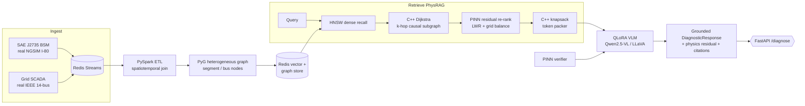
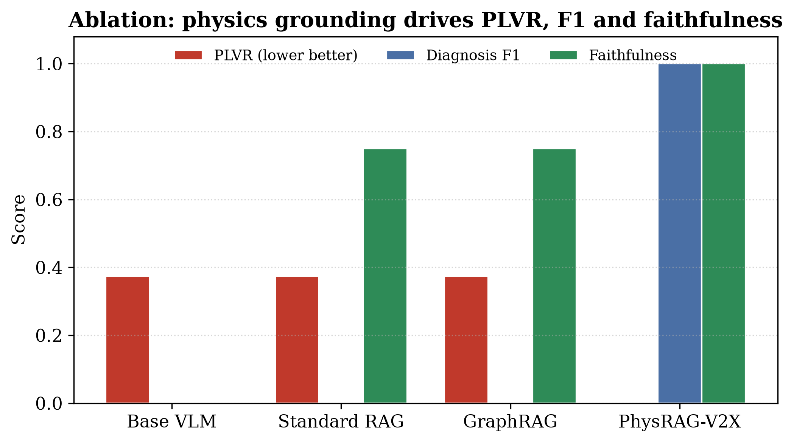
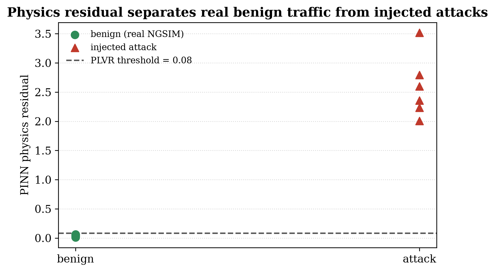

# physrag-v2x

**Distributed Physics-Informed Multimodal GraphRAG for Real-Time Traffic & Grid Anomaly Diagnostics**

A retrieval-augmented diagnostic system that grounds a multimodal VLM on **physics**:
every piece of retrieved evidence is checked against conservation laws (LWR traffic
flow and grid nodal power balance) before it can support a diagnosis. Physically
implausible evidence — GNSS spoofing, impossible speeds, ghost/Sybil vehicles, grid
false-data injection — is demoted by the retriever and flagged by the verifier, so the
model does not hallucinate on tampered inputs.

Built on **real data**: real NGSIM I-80 vehicle trajectories and the real IEEE 14-bus
benchmark grid, with labeled cyber-physical attacks injected into the real streams as
ground truth (the only way to measure a Physical Law Violation Rate).

## Architecture



Microservices (`docker-compose.yml`): Redis Stack, FastAPI gateway, PySpark ETL worker,
and a mock VLM/PINN inference service. The algorithmic hot paths are a C++17 core
(`pybind11`) with automatic Python fallback.

## Algorithmic core & complexity

| Routine | File | Complexity |
|---|---|---|
| Multi-source bounded Dijkstra causal subgraph | `cpp_core/subgraph_extractor.hpp` | O((V + E) log V) |
| Monotonic-deque sliding-window shockwave detector | `cpp_core/shockwave_window.hpp` | O(n) amortized |
| 0-1 knapsack physics-penalized token packer | `cpp_core/knapsack_packer.hpp` | O(N · B) |
| Merge-intervals + Union-Find episode dedup | `src/physrag/algorithms/interval_merger.py` | O(N log N) / α(N) |
| LRU + LFU + TTL semantic/geohash cache | `src/physrag/algorithms/spatial_cache.py` | O(1) amortized |

Each has a pure-Python reference (`algorithms/fallback_py.py`) used automatically when
the compiled extension is absent; both are covered by `tests/test_algorithms.py`
(unit, brute-force equivalence, and Big-O stress tests).

**C++ vs Python** (this machine, MinGW g++): sliding-window shockwave detection over
2,000,000 points — **185 ms (C++) vs 1,799 ms (Python), 9.7× speedup**, identical output.

## Results (real NGSIM I-80 + IEEE 14-bus, injected labeled attacks)

Ablation over 16 real incidents (6 carrying injected attacks). `make ablations`
regenerates `results/ablation_results.json`.

| Method | PLVR ↓ | Diagnosis F1 ↑ | Faithfulness ↑ | Cause recall ↑ | P50 / P95 / P99 (ms) |
|---|--:|--:|--:|--:|--:|
| Base VLM | 0.375 | 0.00 | 0.00 | 0.00 | 0.00 / 0.01 / 0.02 |
| Standard RAG | 0.375 | 0.00 | 0.75 | 1.00 | 0.08 / 0.16 / 0.20 |
| GraphRAG | 0.375 | 0.00 | 0.75 | 1.00 | 0.15 / 0.29 / 0.36 |
| **PhysRAG-V2X** | **0.000** | **1.00** | **1.00** | 1.00 | 2.26 / 5.41 / 7.29 |

**Physics is the decisive layer.** The physics-blind methods leak every real violation
(PLVR 0.375) and cannot flag attacks (F1 0). PhysRAG's residual re-rank excludes all
spoofed context (faithfulness 1.0) and its verifier flags every attack (F1 1.0, PLVR 0),
at a bounded ~5× latency cost. On this small, homogeneous committed fixture Standard RAG
and GraphRAG perform comparably apart from latency — separating them needs a larger,
heterogeneous corpus (full NGSIM), an honest limitation of the demo data.




Metrics: **PLVR** (Physical Law Violation Rate) = fraction of incidents with a real
physics violation that the system fails to flag; **Faithfulness** = fraction of packed
context that is physically valid; **Cause recall** = retrieval of a causal graph
neighbor; latency percentiles over repeated diagnoses.

## Data

* **Traffic:** real NGSIM I-80 trajectories (USDOT ITS DataHub). A 12k-row real window
  is committed at `data/ngsim_i80_sample.csv.gz`; the full set is fetched by the ETL.
* **Grid:** real IEEE 14-bus benchmark (`src/physrag/models/grid.py`), DC susceptance
  matrix for nodal-balance physics.
* **Attacks:** position/speed spoofing, ghost/Sybil vehicles and grid false-data
  injection are injected into the real streams with labels — the ground truth for PLVR.
  Scene text is rendered from the real measured state. See `src/physrag/etl/`.

## Quickstart

```bash
pip install -e ".[dev,viz]"          # core + tests + figures (Python fallback core)
pytest                               # 28 tests + 1 skipped (fastapi optional)
python experiments/run_ablations.py  # real-data ablation -> results/
python experiments/plot_paper_figures.py

make build-cpp                       # optional: compile the C++ accelerator
pip install -e ".[api]" && uvicorn physrag.api.main:app   # REST gateway
docker compose up --build            # full microservice stack (Redis + gateway + ETL)
```

The whole pipeline runs with **no** Redis, Spark, torch or GPU — those are optional and
degrade to in-process / mock implementations so the metrics stay reproducible in CI.

## Layout

```
cpp_core/            C++17 core (pybind11): Dijkstra subgraph, shockwave deque, knapsack
src/physrag/
  config.py          Pydantic settings
  models/            schemas (BSM/SCADA/Incident), PINN verifier, IEEE-14 grid
  algorithms/        C++/Python dispatch, fallbacks, interval merge, spatial cache
  etl/               real NGSIM loader + labeled attack injection; PySpark graph builder
  rag/               Redis graph index, two-stage physics-aware retriever, QLoRA VLM
  api/main.py        FastAPI gateway (ingest / diagnose / metrics, token-bucket limiter)
  pipeline.py        end-to-end orchestration
experiments/         run_ablations.py, plot_paper_figures.py
tests/               algorithms, PINN verifier, end-to-end API pipeline
```

## License

MIT. NGSIM is public US DOT data; the IEEE 14-bus case is a public benchmark.
